# Ryciny

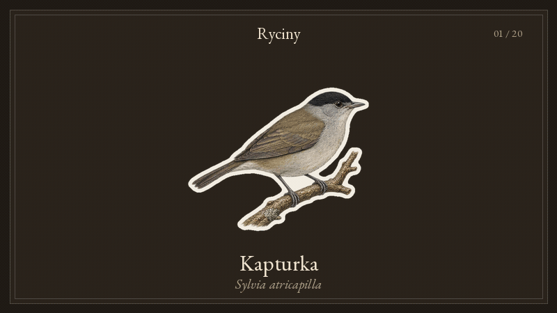

Losowy przegląd 20 animacji: ptaki, dźwięki okolicy, pies i samolot.
Każda rycina odtwarza dwa cykle, a cały podgląd zapętla się.

Ramka w stylu [fugleramme](https://github.com/arnegiacomo/fugleramme): telefon cały czas słucha okolicy
i rysuje na „papierze” XIX-wieczne ryciny tego, co się dzieje wokół domu:

- **ptaki** rozpoznane po śpiewie (BirdNET 6K v2.4, w telefonie, z filtrem gatunków dla miejsca i pory roku),
- **samolot**, który właśnie przelatuje: typ, linia, rejestracja, trasa skąd-dokąd, wysokość i odległość
  (dane ADS-B z adsb.lol + adsbdb),
- **psy**, które szczekają w okolicy: wykrywanie szczekania (YAMNet), rozpoznawanie konkretnych psów
  z sąsiedztwa i ich ras,
- **pociągi**: gdy mikrofon usłyszy pociąg, aplikacja dopasowuje go do rozkładu wszystkich polskich pociągów
  (SKM Trójmiasto, PolRegio, Intercity…) i pokazuje przewoźnika, numer, skąd i dokąd jedzie,
- **dźwięki okolicy** (34 rodzaje, YAMNet): kosiarka i piła u sąsiada, burza, deszcz, wiatr, statki i syrena
  mgłowa z portu, dzwony kościelne, pociąg, samochód, motocykl, helikopter, karetka, policja, straż, fajerwerki,
  kot, kogut, zwierzęta gospodarskie, żaby, świerszcze, pszczoły, muzyka, zabawa dzieci, rozmowy, dzwonek do
  drzwi, lodziarz. Każdy ma własną rycinę. Pełna lista z progami i promptami jest w
  [`shared/sounds.json`](shared/sounds.json). Przy rozmowach i dzieciach zapisuje się tylko sam fakt: dźwięk nie
  jest nagrywany, a słowa nie są rozpoznawane.

Na ekranie jest zawsze **jedna rycina**: najnowsza rzecz z okolicy (samolot nad głową, ostatni ptak,
ostatni pies albo ostatni dźwięk, np. kosiarka czy burza). Dotknięcie przełącza na następną, a gdy pojawi się coś nowego, ekran wraca do niej.

Etap 1 to aplikacja na Androida do testów. Etap 2 to Raspberry Pi z kolorowym ekranem e-ink, jak w fugleramme.

## Jak to wygląda

Wszystko poniżej to zrzuty z Pixela 9 w Gdańsku, zrobione 4 października 2026. Ryciny samolotów, psa
i dźwięków wygenerował `gpt-image-1`, a ptaka narysował John Gould w XIX wieku.

| Ptak | Samolot nad domem | Pies |
| :---: | :---: | :---: |
| 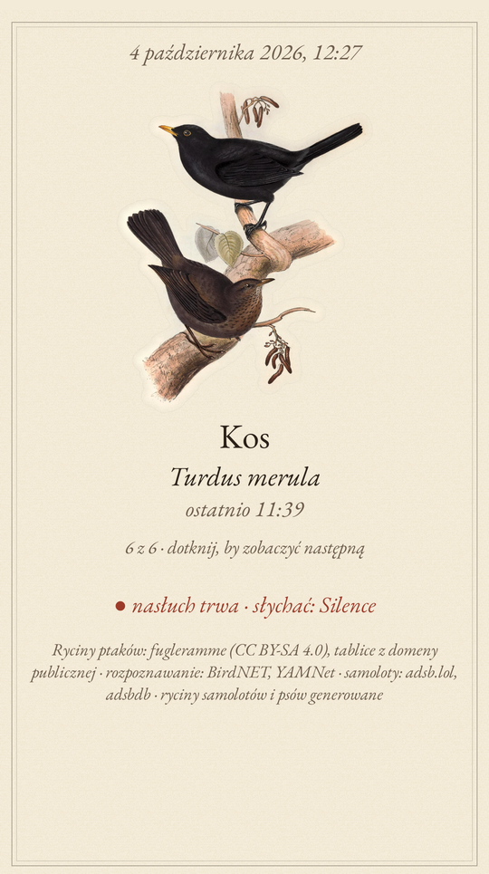 | 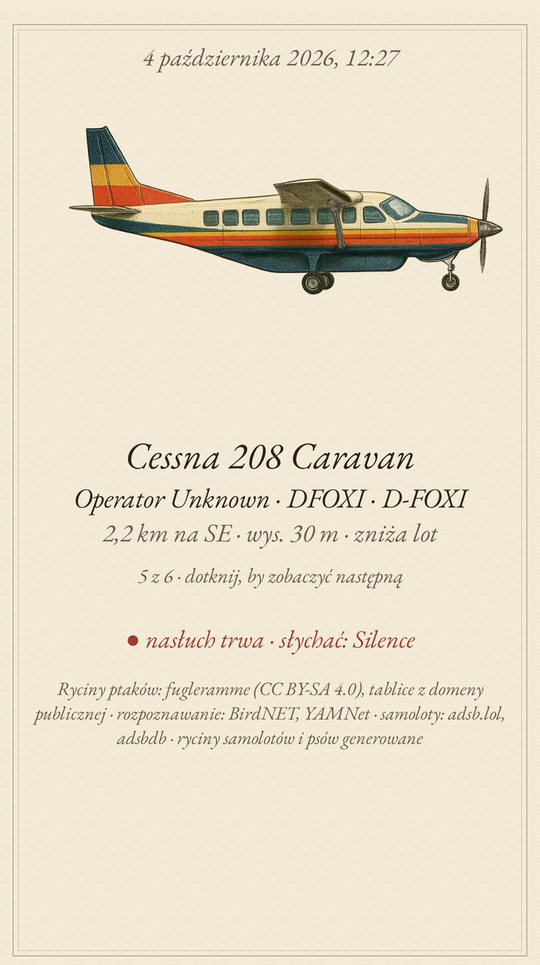 | 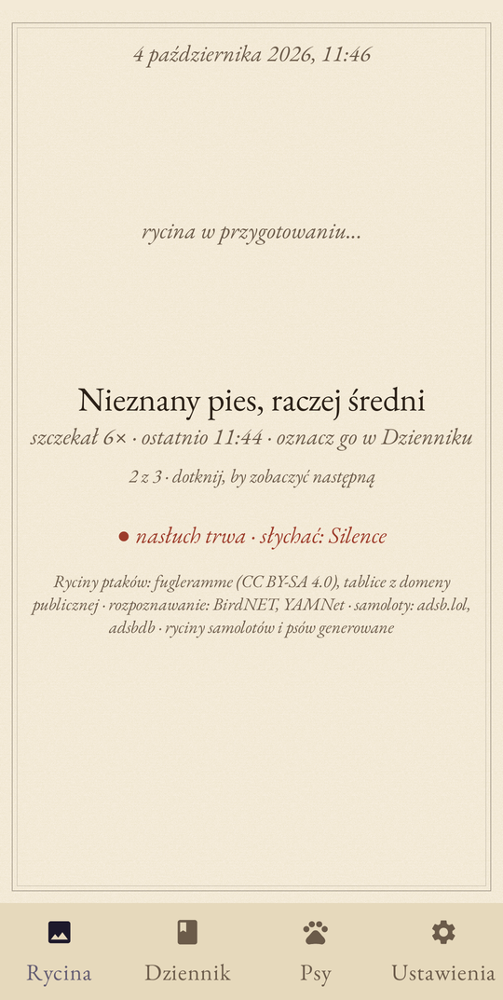 |
| Kos rozpoznany po śpiewie, tablica z fugleramme | Cessna 208 Caravan 2,2 km od domu, 30 m nad ziemią, zniża lot do GDN | Szczekający pies, wielkość zgadnięta z wysokości głosu |

| Sąsiad kosi trawę | Dzwony | Muzyka u sąsiadów |
| :---: | :---: | :---: |
| 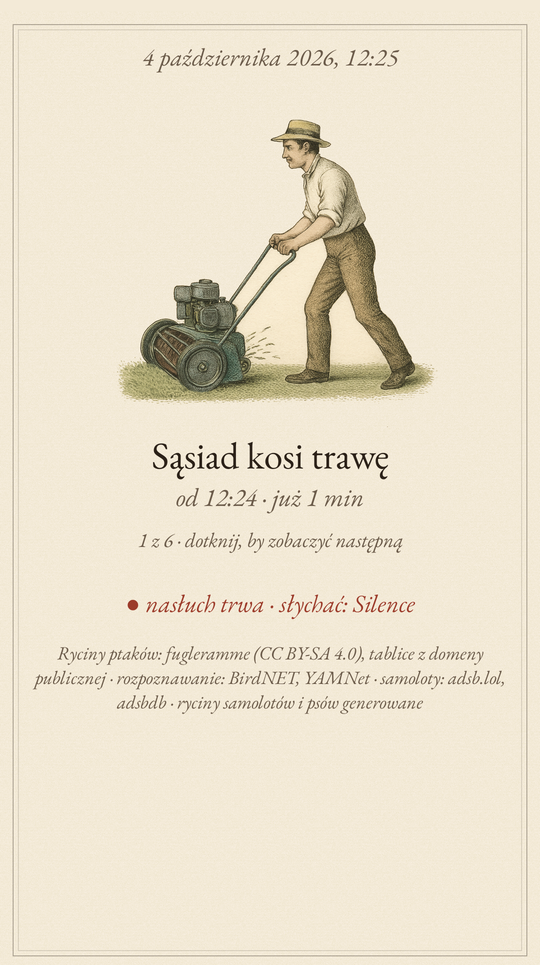 | 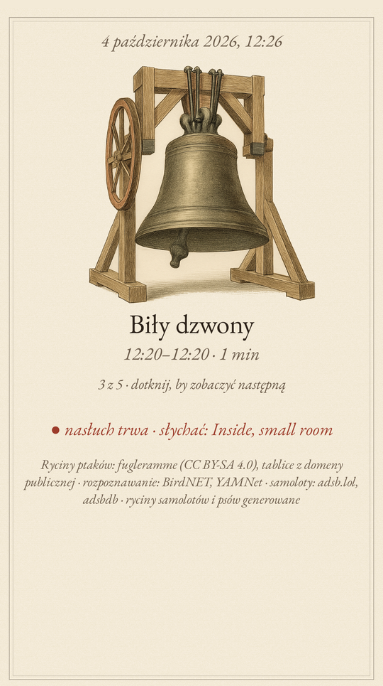 | 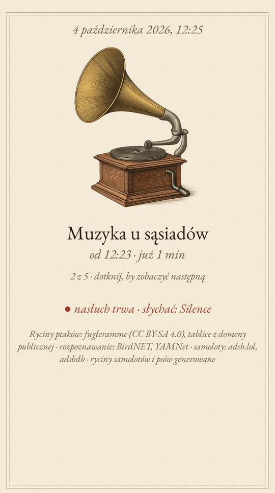 |
| Koszenie trawy jako tablica z XIX-wiecznego poradnika ogrodniczego | Dzwony kościelne | Muzyka zza płotu |

| Dziennik | Rycina samolotu z Dziennika | Psy w Dzienniku | Ustawienia |
| :---: | :---: | :---: | :---: |
| 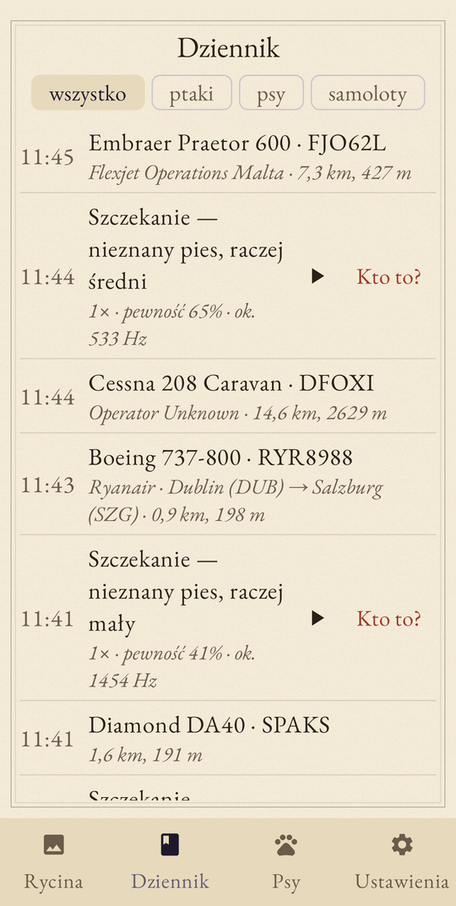 | 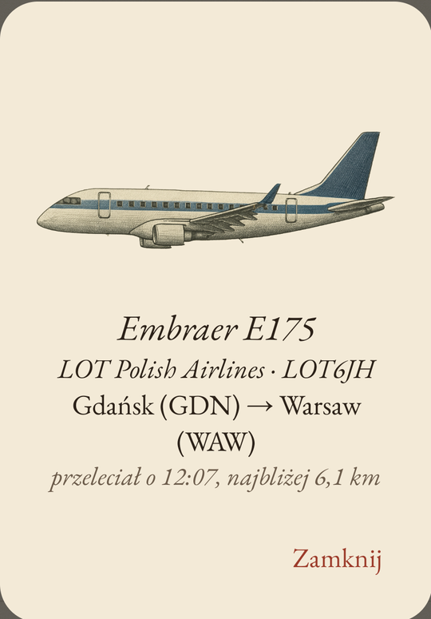 | 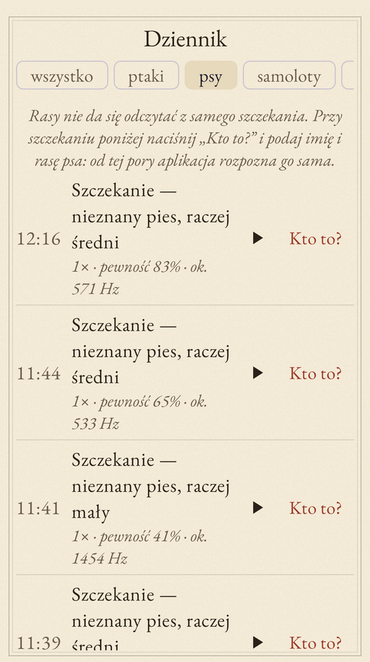 | 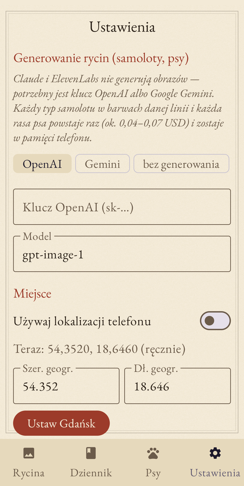 |
| Każdy wpis z miniaturą ryciny: sroka, wrona siwa, samoloty z trasami (Finnair GDN → HEL, Wizz Air GDN → TGD) | „Rycina” przy samolocie: Embraer E175 LOT Gdańsk → Warszawa | Filtr „psy”: znane psy, szczekania do odsłuchania i oznaczenia („Kto to?”) | Klucz do rycin, licznik rycin w pamięci, miejsce |

### Galeria rycin

Same ryciny, tak jak zapisuje je aplikacja: wygenerowane raz, wycięte z tła i trzymane w telefonie.

| | | |
| :---: | :---: | :---: |
|  |  | 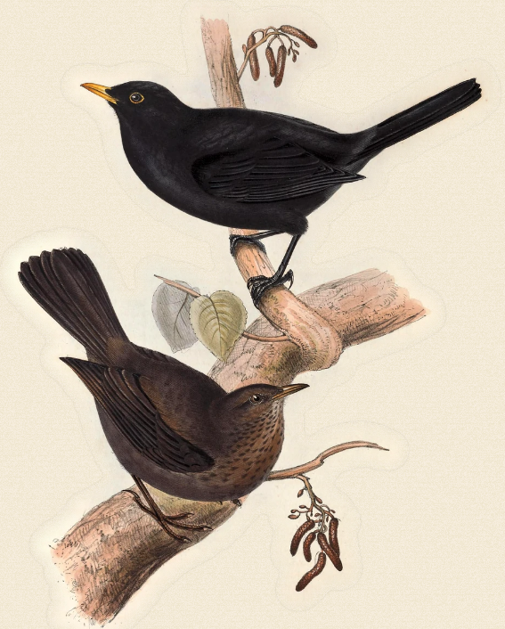 |
| Embraer E175, LOT | Cessna 208 Caravan | Kos (Gould, *Birds of Europe*) |
| 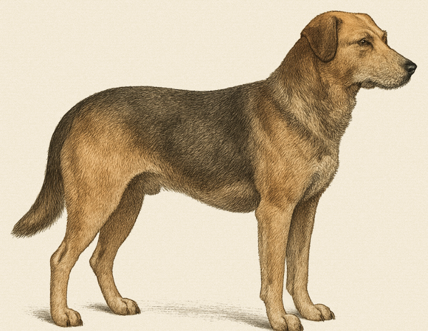 | 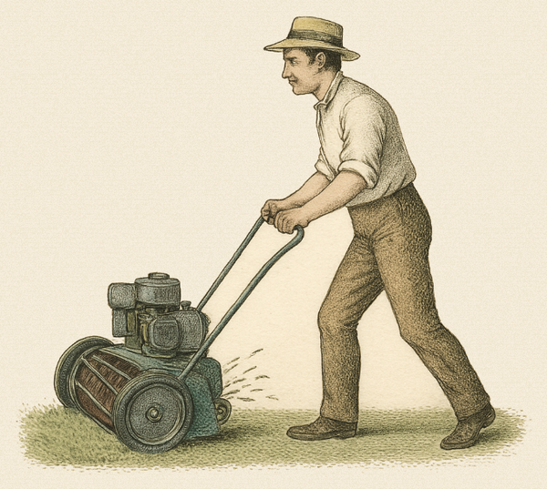 | 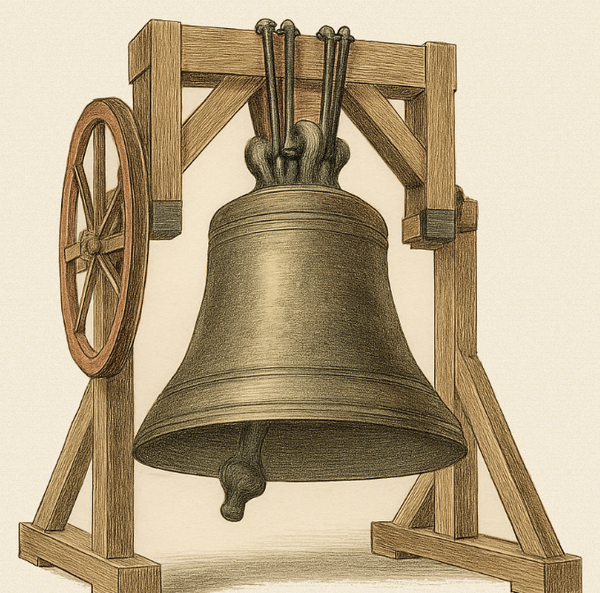 |
| Kundel średniej wielkości | Sąsiad kosi trawę | Dzwony kościelne |
|  | | |
| Muzyka u sąsiadów | | |

## Prepared engraving animations

The add-on can play six cached frames over an existing engraving. Paper, captions,
and layout stay fixed. Fresh installations start with playback and generation off.
Existing saved choices stay in effect after an upgrade.

Prepared frames include sticker backing in a warm paper color made by a separate
Python post-processing pass. The add-on automatically prepares missing outlined
versions when it loads packs or finishes generating new frames, then reuses the
saved result. Each border follows its own frame's silhouette. Raw frames, source
originals, and generation metadata stay intact; validated receipts prevent
repeated application.
See [Add sticker backing](docs/animation-preparation.md#add-sticker-backing).


Pack 5 adds ten everyday sound-scene bundles and brings the repository to 37
prepared bundles. The montage shows the new atlases. Detailed bindings, source
hashes, and provenance are in the [preparation guide](docs/animation-preparation.md)
and [catalog](docs/animation-atlases/catalog.json).

[View the pack 6 montage](docs/animation-atlases/pack-6/moving-images.gif).

Pack 6 adds ten more `SCENE` bundles for tools, a chainsaw, a helicopter,
emergency vehicles, a car alarm, a rooster, frogs, and bees. It brings the
repository to 47 prepared bundles. Each bundle uses one built-in atlas
generation; its runtime original is derived from the first registered atlas
pose. Provider metadata, exact bindings, prompts, and hashes are recorded in
the [preparation guide](docs/animation-preparation.md) and
[catalog](docs/animation-atlases/catalog.json). Playback and generation remain
off by default.

The feature builds on merged [PR #4](https://github.com/qunabu/ryciny/pull/4),
[PR #3](https://github.com/qunabu/ryciny/pull/3), and
[PR #5](https://github.com/qunabu/ryciny/pull/5).

### Enable playback

The Docker image includes prepared bundles by default. Runtime playback needs no
API key and no rebuild.

1. Open the add-on panel and select `Ustawienia`.
2. Under `Animowana rycina`, turn on `Odtwarzaj animacje`.
3. The setting saves immediately and persists across restarts.

**Settings matrix**

| Setting | Default | Control |
| --- | --- | --- |
| `animation_playback` | `false` | `Ustawienia` → `Odtwarzaj animacje` |
| `animation_generate` | `false` | `Ustawienia` → `Generuj animacje dla istniejących i nowych rycin` |
| `animation_model` | `gpt-image-2.5-sunburst` | `Ustawienia` → `Model generowania animacji` |
| `INCLUDE_ANIMATIONS` | `1` | Docker build |

Generation stays separate from playback. Set `Klucz OpenAI` in the Home Assistant
add-on Configuration. Then enable
`Generuj animacje dla istniejących i nowych rycin`, and choose
`Model generowania animacji` to create missing bundles. Without a key, the
worker does no paid work.

`INCLUDE_ANIMATIONS=0` or `false` omits prepared assets from an advanced Docker
build. It does not enable playback. Startup `RYCINY_ANIMATION_*` variables
override saved animation settings when the process loads.

The Home Assistant API exposes descriptors only when `animation_playback` is on.
The Android client in Home Assistant mode follows this gate. Standalone Android,
Generic Camera, Picture entity, and e-ink keep still output. Samsung The Frame
uses its existing still Art Mode output.

The public-site exporter publishes prepared descriptors independently. Its viewer
enables motion by default, remembers an explicit pause, and respects reduced
motion. Miniatures animate on hover and while their recording plays. See the
[full preparation guide](docs/animation-preparation.md) for runtime fallbacks,
generation details, and platform boundaries.

## Sprzęt

Zamówiony: mikrofon Primo EM272Z1 z przedłużaczem 4,5 m, który trafi do komputera z Home Assistant
([plan.md](plan.md)). Wariant bez HA: używany Samsung Galaxy Tab A7 z OLX jako ramka.
Szczegóły, ceny i montaż: [docs/sprzet.md](docs/sprzet.md).

## Instalacja

Krok po kroku, dla samego telefonu i dla Home Assistant (dodatek, mikrofon, panel, dashboard, telefon jako ekran,
Samsung The Frame), z rozwiązywaniem problemów: **[INSTALL.md](INSTALL.md)**.

Skrót: APK z [ostatniego wydania](https://github.com/qunabu/ryciny/releases/latest) na telefon; dodatek do HA
z repozytorium `https://github.com/qunabu/ryciny` (Ustawienia → Dodatki → Sklep → Repozytoria).

Ze źródeł:

```bash
cd android
./gradlew assembleRelease      # wymaga JDK 17 i Android SDK (compileSdk 37)
adb install -r app/build/outputs/apk/release/app-release.apk
```

## Klucz do generowania rycin

Ptaki mają prawdziwe tablice z XIX wieku, wycięte ręcznie przez autora fugleramme (ponad 500 gatunków,
pobierane z jego repozytorium przy pierwszym użyciu). Samolotów i ras psów w takich tablicach nie ma,
więc aplikacja generuje je w tym samym stylu:

- **Claude (Anthropic) i ElevenLabs nie generują obrazów**, ich klucze tu nie pomogą.
- Działa klucz **OpenAI** (`gpt-image-1`), **Google Gemini** (`gemini-2.5-flash-image`) albo
  **OpenRouter** (`sk-or-…`, domyślnie `google/gemini-2.5-flash-image`; można wpisać dowolny model OpenRoutera,
  który generuje obrazy, np. `openai/gpt-5-image-mini`). Wpisz go w Ustawieniach.
- Każdy typ samolotu w barwach danej linii (np. Embraer E175 LOT), każda rasa psa i każdy dźwięk okolicy powstają raz
  i zostają w telefonie. Nic nie jest generowane drugi raz: zamówiony obraz dokańcza się nawet po przełączeniu
  ekranu, a oryginał z API jest zapisywany przed wycinaniem tła. Ryciny minionych samolotów można też
  wygenerować z Dziennika (przycisk „Rycina” przy samolocie). Rycina kosztuje ok. 0,04–0,07 USD. Przy lotnisku w Gdańsku to kilkadziesiąt
  kombinacji, czyli w sumie kilka dolarów.
- Wygenerowany obraz jest wycinany z tła (PNG z przezroczystością, maks. 1200 px), czyli ma ten sam format
  co tablice fugleramme.

Prompty są w [`shared/style.json`](shared/style.json); zmień je, jeśli chcesz inny styl.

## Jak działa rozpoznawanie psów (i czego nie umie)

Żaden model nie rozpozna rasy psa z samego szczekania. Szczekanie owczarka i labradora brzmi podobnie,
a dwa jamniki mogą brzmieć zupełnie inaczej. Dlatego aplikacja robi to, co da się zrobić rzetelnie:

1. **Wykrywa szczekanie**: YAMNet (Google, AudioSet) ma klasy *Dog / Bark / Yip / Howl / Growling*.
2. **Szacuje wielkość** z wysokości głosu (duży < 380 Hz < średni < 650 Hz < mały). To tylko szacunek.
3. **Uczy się psów z sąsiedztwa**: w Dzienniku przy szczekaniu jest odtwarzanie i przycisk **„Kto to?”**.
   Oznaczasz psa raz (imię + rasa), a aplikacja zapisuje „odcisk” jego szczekania (1024-wymiarowe
   embeddingi YAMNet). Kolejne szczekania porównuje z zapisanymi próbkami (podobieństwo kosinusowe,
   próg w Ustawieniach, domyślnie 85%). Im więcej oznaczeń danego psa, tym pewniej go rozpoznaje.

Rasa na rycinie to ta, którą wpiszesz przy oznaczaniu psa. Nieoznaczony pies jest rysowany jako kundel
zgadniętej wielkości. Próg dopasowania trzeba będzie pewnie dostroić na prawdziwych psach: jeśli myli psy,
podnieś go, a jeśli nie poznaje znanych, obniż albo oznacz więcej próbek.

## Pociągi

- Rozkład: [polish_trains.zip z mkuran.pl](https://mkuran.pl/gtfs/) (GTFS z otwartych danych PKP PLK), 30 MB,
  pobierany przez Wi-Fi raz na 3 dni. Raz dziennie aplikacja wylicza z niego pociągi, których trasa przechodzi
  w promieniu 1,5 km od domu, i moment, w którym mijają dom.
- Gdy YAMNet usłyszy pociąg, aplikacja bierze z tej listy przejazd najbliższy w czasie (±5 min) i zapisuje
  „PolRegio 96226 · Gdańsk Osowa → Gdańsk Wrzeszcz · planowo 13:40”.
- Opóźnienia nie są uwzględniane: plik z danymi na żywo ma 23 MB, za dużo do pobierania co kilka minut na telefonie.
  Pociąg spóźniony o ponad 5 minut może zostać pomylony z następnym albo zostać bez dopasowania.

## Samoloty

- Pozycje: [adsb.lol](https://adsb.lol) (społecznościowa sieć ADS-B, bez klucza), odpytywane co 10 s,
  tylko gdy ekran jest włączony albo działa nasłuch.
- Typ, linia i trasa: [adsbdb.com](https://www.adsbdb.com). Trasy są przypisane do numeru lotu, więc
  czasem bywają nieaktualne.
- „Nad głową” to najbliższy samolot w linii prostej poniżej ustawionej wysokości (domyślnie 3500 m,
  promień 15 km). Pozostałe są wypisane drobnym drukiem.
- Gdy mikrofon usłyszy silnik odrzutowy albo śmigło (YAMNet *Aircraft / Jet engine*), przy samolocie
  pojawia się napis „słychać go teraz”, a w Dzienniku przelot jest oznaczony jako słyszany.

Lokalizacja: GPS telefonu. Bez GPS aplikacja używa współrzędnych z Ustawień (domyślnie centrum Gdańska).
Filtr gatunków BirdNET jest liczony dla tego miejsca i tygodnia roku.

## Struktura

```
shared/                 wspólne dla Androida i Pi
  style.json            prompty rycin
  sounds.json           dźwięki okolicy: klasy YAMNet, progi, prompty
  dog_breeds.json       rasy (pl + en do promptu)
  aircraft_types.json   kody ICAO typów -> nazwy
android/app/src/main/java/pl/wojczal/ryciny/
  audio/                AudioRecord 48 kHz -> okna 3 s -> Analyzer (BirdNET + YAMNet), usługa w tle
  ml/                   BirdNET, filtr zasięgu, YAMNet (LiteRT)
  planes/               adsb.lol + adsbdb
  art/                  tablice fugleramme, generowanie (OpenAI/Gemini/OpenRouter), wycinanie z tła
  data/                 dziennik (JSON), psy, ustawienia, eksport dla Pi
  ui/                   rycina, dziennik (z psami), ustawienia
```

## Samsung The Frame

Rycina może wisieć na telewizorze Samsung The Frame w Art Mode. Telefon wysyła ją przez sieć domową przy każdej
zmianie (nie częściej niż co 15 min), w 3840×2160, i usuwa poprzednią z pamięci telewizora. Ustawienia →
„Samsung The Frame”: wpisz adres IP telewizora (najlepiej zarezerwowany w routerze), naciśnij „Wyślij teraz” i przy
pierwszym razie zezwól pilotem na „Ryciny”. „Podgląd” pokazuje, co pójdzie na telewizor. Na telewizor idą tylko wybrane rodzaje rycin, domyślnie samoloty i ptaki,
z priorytetem dla samolotu z ostatniej godziny. Wyłączenie wysyłania przywraca to, co telewizor pokazywał wcześniej (jego sztukę, pokaz
slajdów, rotację). Protokół jest ten sam,
którego używają integracje Home Assistant ([samsungtvws](https://github.com/xchwarze/samsung-tv-ws-api)).
Ta integracja przesyła statyczny JPEG. Animacje z panelu przeglądarkowego nie są
odtwarzane w Art Mode.

## Home Assistant

Dodatek **Ryciny** robi na komputerze z Home Assistant to samo co telefon: słucha mikrofonu, rozpoznaje i prowadzi
Dziennik. Telefon (Ustawienia → Źródło danych → Home Assistant) tylko wyświetla, a w HA jest panel „Ryciny”
z ryciną, Dziennikiem i ustawieniami. Instalacja: Ustawienia → Dodatki → Sklep → Repozytoria →
`https://github.com/qunabu/ryciny`. Szczegóły: [homeassistant/ryciny/DOCS.md](homeassistant/ryciny/DOCS.md),
plan dalszych kroków: [plan.md](plan.md).

## Etap 2: Raspberry Pi + kolorowy e-ink

Plan: nie przepisywać fugleramme, tylko dołożyć do niego dwa źródła.

| Element | Telefon (teraz) | Raspberry Pi (etap 2) |
| --- | --- | --- |
| Ptaki | BirdNET v2.4 w aplikacji | BirdNET-Go (to samo v2.4), tak jak w fugleramme |
| Psy | YAMNet + embeddingi | ten sam `yamnet.tflite` w Pythonie (ai-edge-litert), te same embeddingi, więc nauczone psy przechodzą 1:1 |
| Samoloty | adsb.lol przez internet | adsb.lol albo własny odbiornik RTL-SDR + readsb (ok. 150 zł, działa bez internetu i widzi więcej) |
| Ryciny | generowane na telefonie | wczytane z eksportu, bez ponownego generowania |
| Ekran | Compose | renderer fugleramme -> Inky Impression 13.3" (Spectra 6) |

Przejście:
1. W aplikacji: **Ustawienia → Eksportuj (ZIP)**. Paczka zawiera `artwork/ryciny/{planes,dogs,birds}/*.png`
   (format stylu fugleramme), `dogs.json` z próbkami szczekania, `journal.json` i pliki z `shared/`.
2. Na Pi: fugleramme + BirdNET-Go według ich instrukcji.
3. Dopisać do fugleramme dwa moduły źródeł: `sky.py` (port `planes/Sky.kt`) i `dogs.py` (YAMNet na tym
   samym strumieniu z mikrofonu, port `audio/Analyzer.kt` + `Dsp.kt`). Fugleramme już teraz wyrzuca etykietę
   BirdNET „Dog” w `taxa.py`, więc pies to jedyne miejsce, gdzie trzeba sięgnąć poza BirdNET-Go.
4. Rozszerzyć kolaż fugleramme o pas „niebo” (samolot) i „psy”.

## Wersje

Numeracja `MAJOR.MINOR.PATCH`. Wersja jest w jednym miejscu: `android/gradle.properties` (`ryciny.version`),
a `versionCode` Androida wylicza się z niej (0.1.0 → 100). Każde wydanie ma tag `vX.Y.Z` i release na GitHubie
z plikiem APK. Lista zmian: [CHANGELOG.md](CHANGELOG.md).

Nowe wydanie:

```bash
# podbij ryciny.version w android/gradle.properties i dopisz wpis w CHANGELOG.md
cd android && ./gradlew assembleRelease
cp app/build/outputs/apk/release/app-release.apk ryciny-v0.2.0.apk
git tag v0.2.0 && git push --tags
gh release create v0.2.0 ryciny-v0.2.0.apk --notes-file <(sed -n '/## 0.2.0/,/## 0.1/p' ../CHANGELOG.md)
```

## Licencje

- Kod: na razie bez licencji (wszystkie prawa zastrzeżone).
- Ryciny ptaków: [fugleramme](https://github.com/arnegiacomo/fugleramme), CC BY-SA 4.0, z tablic
  w domenie publicznej (Gould, von Wright i inni). Lista źródeł jest w `manifest.json` stylu *classic*.
- BirdNET v2.4 (modele i etykiety): CC BY-NC-SA 4.0, K. Lisa Yang Center for Conservation Bioacoustics.
  Tylko do użytku niekomercyjnego.
- YAMNet: Apache 2.0. EB Garamond: OFL. `birdnet_aliases.json`, `bird_sizes.csv`: z fugleramme / OpenFauna, CC BY-SA 4.0.
